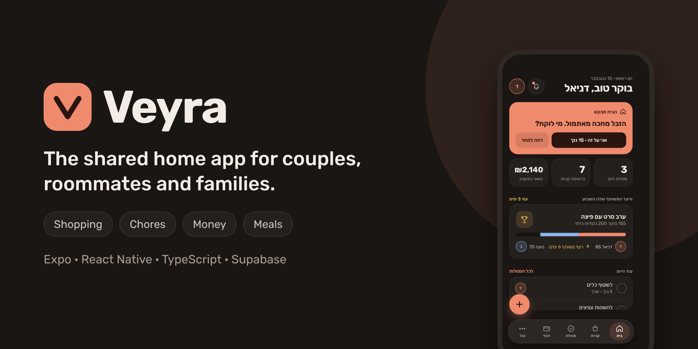
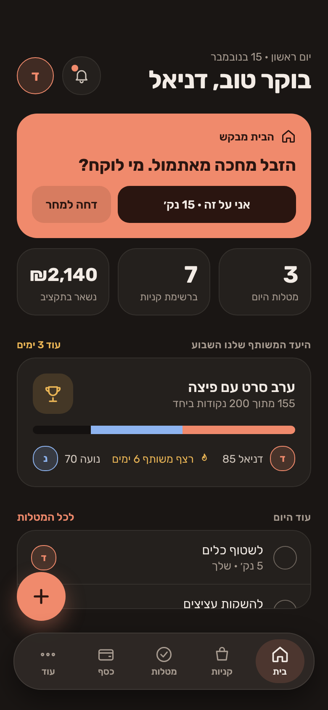
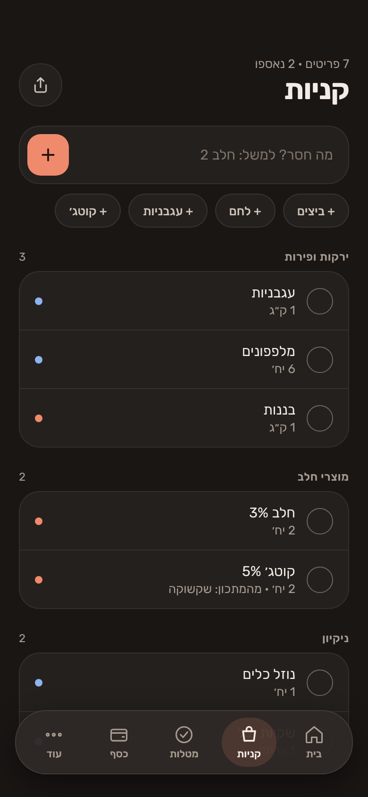
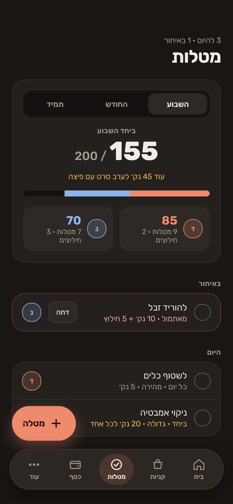
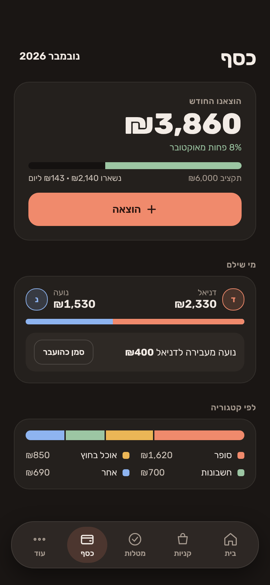

<p align="center">
  
</p>

<p align="center">
  <b>Shopping · Chores · Money · Meals · Calendar · Us</b><br>
  Hebrew (RTL) · English · Russian
</p>

---

**Veyra** is a shared home app for couples, roommates and families (up to 20 people per home).
Everyone in the home sees the same shopping list, chores, expenses, calendar and meal plan, and every change appears on every phone in real time.

It is a from-scratch rebuild of my earlier app **HomeSync**, now on Expo and Supabase.

## Design

<p align="center">
  
  
  
  
</p>
<p align="center"><sub>Design mockups (Hebrew): Home · Shopping · Chores · Money</sub></p>

## Features

| Area | What it does |
| --- | --- |
| **Shopping** | Live shared list grouped by supermarket aisle, quantities and units, search, and a category memory that learns where you put each item |
| **Chores** | Points by effort (5 / 10 / 20), rotating turns, joint chores, a ×1.5 bonus for rescuing an overdue chore, a weekly team goal with a shared reward, and a leaderboard |
| **Money** | Expenses split equally or by percentage, balances, settle-up with the fewest transfers, and a monthly budget |
| **Meals** | Weekly meal plan, 30 built-in recipes plus your own, one tap to add ingredients to the list |
| **Calendar** | Shared household events with reminders |
| **Us** | Date ideas with star ratings, a corkboard of pinned notes, shared savings goals, birthday reminders (plus a 3-day heads-up) |
| **Reminders** | Local notifications: morning summary, evening nudge for open chores, birthdays and events |
| **Account** | Email code sign-in (no passwords), pause account, leave home, delete now or in 30 days, in the app or [on the web](https://roberttonikyan.github.io/veyra/delete.html) |
| **Accessibility** | Screen reader labels and roles, dynamic text size, reduced motion support, full RTL |

## Tech stack

- **App:** Expo SDK 58, React Native, Expo Router, TypeScript, TanStack Query
- **Backend:** Supabase (Postgres 17, Auth, Realtime, Storage, pg_cron), EU region
- **Builds:** EAS Build

## How it works

- **Security in the database.** Every table has Row Level Security; a member can only read and write their own home's rows. Multi-step actions (adding an expense with its shares, completing a chore, redeeming an invite, deleting an account) run as `security definer` RPCs with a fixed `search_path` and their own membership checks. The anonymous role has no table access at all.
- **Realtime.** One `RealtimeSync` component subscribes to the household's changes and invalidates the matching TanStack Query keys, so every screen stays fresh without polling.
- **Money in integers.** Amounts are stored in agorot (integer cents); settle-up uses a greedy minimum-transfers algorithm in SQL.
- **Session storage.** The Supabase session is AES-encrypted on the device, with the key kept in the secure keychain.
- **i18n.** Hebrew, English and Russian JSON dictionaries with plural rules per language; key parity is checked on every change.

## Getting started

```bash
git clone https://github.com/RobertTonikyan/veyra.git
cd veyra
npm install
```

Create `.env.local` with your Supabase project's URL and publishable key:

```bash
EXPO_PUBLIC_SUPABASE_URL=https://<project-ref>.supabase.co
EXPO_PUBLIC_SUPABASE_PUBLISHABLE_KEY=sb_publishable_...
```

Apply the SQL migrations in `supabase/migrations/` to your project (in order), then:

```bash
npx expo start
```

Useful scripts: `npm run typecheck`, `npm run db:types` (regenerates `src/types/database.ts`).

## Project structure

```
src/
  app/            screens (Expo Router): (auth), (onboarding), (tabs), settings, meals, calendar, us
  features/       one folder per feature: api hooks + components
  household/      current household, members, realtime sync
  auth/           session provider
  i18n/           he / en / ru dictionaries
  services/       Supabase client, query client, errors, links
  ui/             design system: tokens, Text, Button, Card, Sheet…
supabase/migrations/   database schema, policies and functions
docs/                  public site: privacy policy and account deletion page
```

## Privacy

No ads, no analytics, no tracking. See the [privacy policy](https://roberttonikyan.github.io/veyra/privacy.html).
Questions: [veyrarobert@gmail.com](mailto:veyrarobert@gmail.com)

---

Built by [Robert Tonikyan](https://github.com/RobertTonikyan).
